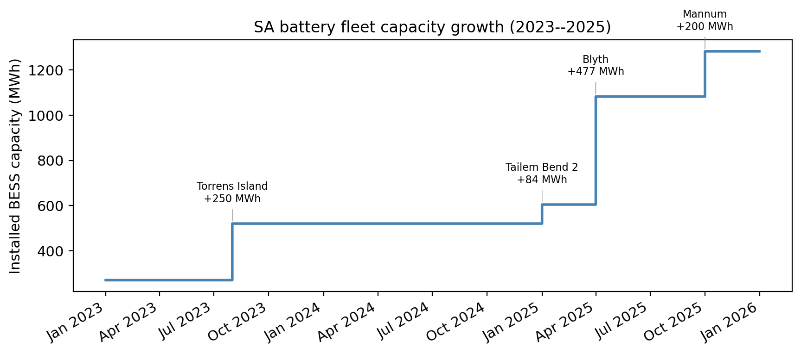
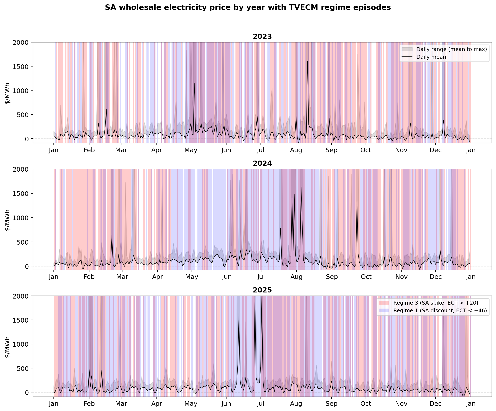
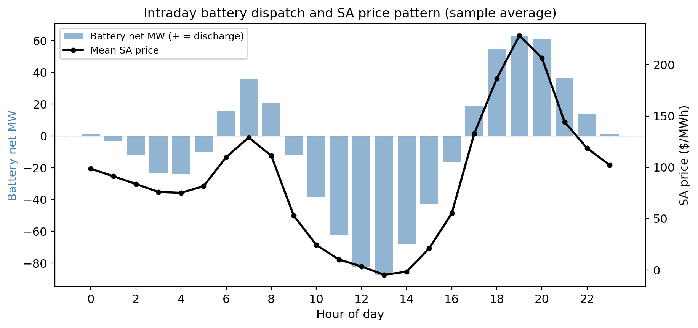
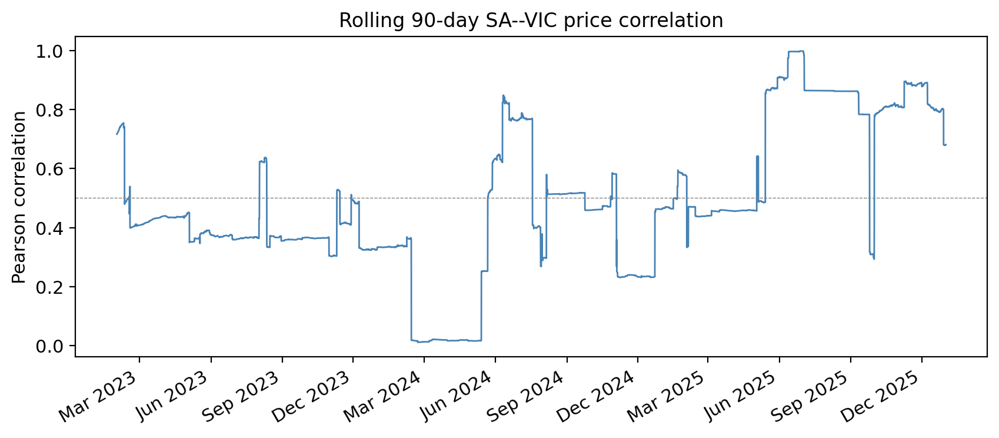
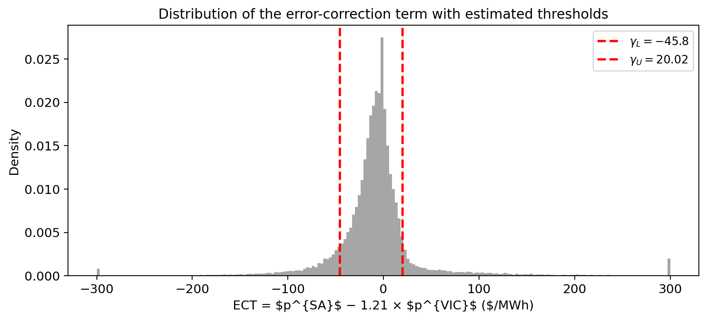
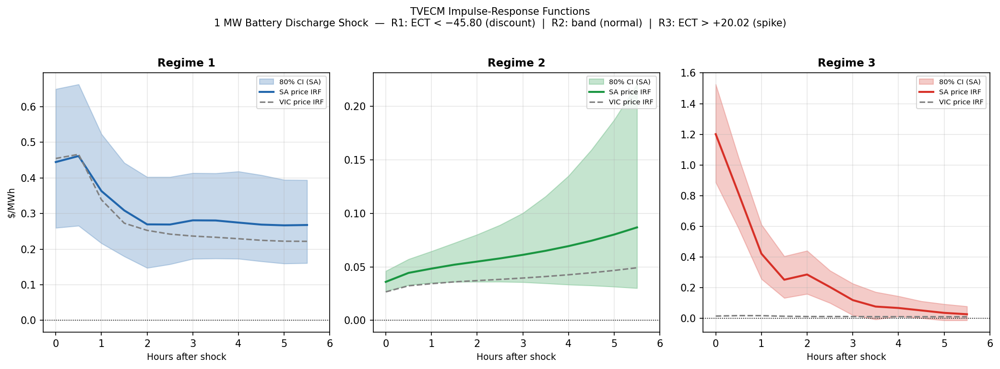

# Battery Storage and Electricity Price Convergence

### A Threshold Vector Error-Correction Analysis of the South Australian–Victorian Market

> Empirical study of battery energy storage and wholesale electricity price dynamics in Australia's National Electricity Market, 2023–2025.

---

## Overview

South Australia (SA) is one of the highest-renewable grids in the world — wind and solar averaged **90% of operational demand** over 2023–2025, and **27.5%** of half-hourly settlement prices were negative. At the same time, the right tail is extreme: 0.4% of intervals exceed **\$1,000/MWh**, with a maximum above **\$16,970/MWh**.

Against this backdrop, SA's battery energy storage system (BESS) fleet expanded **4.7-fold** (271 → 1,282 MWh) in three years. This project asks a single causal question:

> **Does a growing BESS fleet exert a measurable causal dampening effect on wholesale electricity prices, and does this effect vary across price regimes?**

The answer requires resolving a textbook **simultaneity paradox**: batteries discharge *because* prices are already spiking, so naïve OLS produces a counter-intuitive positive coefficient (+1.20\*\*\*) on battery discharge in the spike regime. Six independent identification strategies (lagged regressors, 2SLS with a commissioning-event instrument, GARCH-M, Markov-switching, jump-diffusion, capacity-interaction) all point in the same direction once endogeneity is addressed: **batteries prevent spikes from forming, rather than blunt them once they have started**.

---

## Headline Results

| Metric | Value |
|---|---|
| Sample | 52,608 half-hourly observations, 1 Jan 2023 → 31 Dec 2025 |
| Cointegrating vector (Johansen) | `ECT = p_SA − 1.2103 × p_VIC` |
| Threshold band (Hansen–Seo, *p* = 0.030) | γ_L = −\$45.80, γ_U = +\$20.02 /MWh |
| Spike-regime SA half-life | **0.8 h** (α = −0.349\*\*\*) |
| OLS bias (β_dis, spike regime) | **+1.20\*\*\*** → reverses sign under lagged regressors (−0.19) |
| First-stage partial F (SOC instrument) | 30 – 200 across regimes (all strong) |
| Sargan over-id (SOC + Z\_newcap) | **passes in all three regimes** |
| Consumer welfare gain (counterfactual) | **\$10.83 M / year** |
| Decline in OLS simultaneity bias by 2025 | **94 %** (capacity-interaction) |
| SA–VIC price correlation | 0.38 (2023) → **0.80** (2025) |
| Spike-regime frequency | 9.4 % (2023) → **5.0 %** (2025) |

---

## Key Visuals

### SA fleet capacity growth (step function)


### SA wholesale price with TVECM regime episodes


### Intraday battery dispatch vs SA price (duck-curve)


### Rolling 90-day SA–VIC price correlation


### Distribution of the error-correction term with estimated thresholds


### Bivariate impulse-response: 1 MW discharge shock by regime


---

## Methodology — what is used and why

The project applies a **chained sequence of econometric techniques**, where each method either tests an assumption of the next, or provides a robustness check on the previous one.

### 1. Pre-estimation diagnostics

- **Unit root tests** — ADF (Dickey & Fuller 1981), Phillips–Perron, KPSS (Kwiatkowski et al. 1992). KPSS is preferred over ADF/PP because spike outliers bias ADF-type tests towards rejection (Escribano et al. 2011; Weron 2006). Both price series are treated as I(1).
- **Johansen cointegration** (Johansen 1988) — identifies one cointegrating vector with normalised coefficient β = 1.2103. ECT is confirmed stationary via ADF (stat −38.96, *p* < 0.001).
- **Hansen–Seo two-threshold test** (Hansen 1997, 1999; Hansen & Seo 2002) — Sup-LM Rademacher wild bootstrap selects a three-regime specification over a single-threshold and a symmetric-band alternative (*p* = 0.030; lowest AIC/BIC).

### 2. Core model — Three-regime TVECM

For each regime *r* ∈ {1, 2, 3}, OLS with **Newey–West HAC** standard errors (Newey & West 1987, 12 lags):

```
Δp_SA_t = μ_r + α_r · ECT_{t-1}
        + Σᵢ₌₁⁴ φᵢʳ · Δp_SA_{t-i}  + Σᵢ₌₁⁴ ψᵢʳ · Δp_VIC_{t-i}
        + β_dis_r · B_dis_t  + β_chg_r · B_chg_t          ← battery
        + γ'ʳ · x_t                                        ← controls
        + ε_t
```

Controls `x_t`: wind, solar, demand, interconnector flow, calendar dummies (holidays, weekends, time-of-day buckets). Same equation estimated for `Δp_VIC_t`.

Regime membership is determined by lagged ECT relative to (γ_L, γ_U): Regime 1 = SA deep discount, Regime 2 = no-arbitrage band, Regime 3 = SA price spike.

### 3. Identification — three strategies for the causal battery effect

| # | Strategy | What it removes / adds |
|---|---|---|
| 1 | **Predetermined (lagged) regressors** | Cuts the contemporaneous simultaneity channel. Sign of β_dis flips from +1.20\*\*\* to −0.19 in the spike regime. |
| 2 | **2SLS / Instrumental variables** | Primary instrument: capacity-normalised 12-h state-of-charge, `Z_SOC = Σ(B_chg − B_dis)·0.5h / K_{t-1}`. Validating instrument: `Z_newcap`, MWh commissioned in 14-day window ending at *t*−1 (exogenous because construction timelines are pre-determined years in advance by project finance). First-stage F = 30–200, Sargan over-id passes in all three regimes. |
| 3 | **Static counterfactual** | Constructs a "no-battery" price path: `sa_CF_t = sa_actual − Σ_{s≤t} β_r(s)·B_{s}`. Welfare gain ≈ **\$10.83 M / year** of consumer surplus. |

**Wu–Hausman** (Hausman 1978) endogeneity test confirms endogeneity in R1 and R2 (*p* < 0.001) but not R3 (*p* = 0.731). For R3 the lagged-regressor estimator is therefore the preferred causal point estimate; IV remains the headline strategy for R1/R2.

### 4. Robustness layer

| Phase | Method | What it tests | Result |
|---|---|---|---|
| 5 | **Lag-order sensitivity** (L ∈ {4, 6, 8, 10, 12}) | Whether truncation explains residual autocorrelation in outer regimes | β_dis stable within 0.04 across all L. AR is volatility-clustering, not lag-misspecification. |
| 6 | **Rolling thresholds** (annual / semi-annual) | Time-varying band as fleet grows | R3 frequency falls 9.4% → 5.0%; bandwidth widens (partly artifact of min-regime constraint). |
| 7 | **TVECM-GARCH(1,1)-*t* in-mean** (Engle 1982; Bollerslev 1986) | Whether OLS is contaminated by IGARCH dynamics or risk premia | β_dis change < 0.03; IGARCH in R2/R3 confirmed; standardised-residual AR resolved. |
| 8 | **Bivariate impulse-response** (Rademacher wild bootstrap CI) | Persistence of a 1 MW discharge shock | R3 shock decays to +0.03 \$/MWh within 6 h (half-life ≈ 2 periods, 1 h). |
| 9 | **Battery × capacity interaction** | Whether the effect strengthened as the fleet grew | γ_dis significant (R2: *p* = 0.001; R3: *p* = 0.001). OLS coefficient shrinks 75–84 % from 2023 to 2025. |
| 10 | **Lagged-battery R3 robustness** (3 sub-approaches) | Whether the spike-regime causal effect can reach significance | Negative sign preserved across all specs; significance limited by R3 residual SD ≈ \$589/MWh. |
| 11 | **Markov-switching ECM** (Hamilton 1989; Kim 1994) | Whether volatility-based latent regimes confirm the TVECM finding | β_dis negative in all three states (S1, S2 at *p* < 0.001 covering 98.5 % of obs). The high-volatility state independently recovers **α = −0.352\*\*\*** — essentially identical to the TVECM spike-regime estimate of **−0.349\*\*\*** — even though the two models segment the sample by completely different criteria (ECT level vs conditional variance). Custom Hamilton-filter + EM implementation (statsmodels broken on NumPy 2.4). |
| 12 | **Merton-type jump-diffusion** (Merton 1976; Weron 2006) | Whether spikes are best modelled as a Poisson jump process, and whether batteries suppress arrival rate | β_dis = −0.054\*\*\* (direct dampening in drift). λ_dis = +0.005\*\*\* (battery operators *anticipate* jumps; strategic positioning, not causal raising). AIC improves by 213,849 over OLS. |

### 5. Why this combination?

The hypothesis is not "batteries always reduce spot prices" — that is too coarse. The hypothesis is **regime-dependent and timing-dependent**: batteries cannot reverse a spike that is already cleared by gas peakers (merit-order logic), but strategic discharge ahead of anticipated scarcity *prevents* a spike from materialising. This requires:

1. A **regime-aware** core model → TVECM with Hansen–Seo thresholds.
2. **Endogeneity-corrected** estimates → lagged regressors + IV with a credible instrument set.
3. A **welfare quantification** → static counterfactual against the estimated coefficients.
4. **Direct evidence of the timing channel** → jump-diffusion model, which separates drift (causal) from arrival rate (strategic anticipation).
5. **Cross-validation of the regime classification** → Markov-switching ECM, which lets the data choose regimes endogenously.

---

## What this means for energy trading

The estimated parameters are not just academic — most translate directly into trading signals, risk parameters, or pricing inputs.

### 1. Statistical arbitrage on the SA–VIC spread

The TVECM gives a closed-form mean-reversion model for the SA-minus-1.21×VIC spread:

| Signal | Threshold | Half-life | Direction |
|---|---|---|---|
| ECT > +\$20 /MWh (spike regime) | enter short SA / long VIC | **0.8 h** | SA corrects (α = −0.349\*\*\*) |
| ECT < −\$46 /MWh (discount regime) | enter long VIC | ~1.3 h | VIC corrects (α = +0.525\*\*\*) |
| −\$46 ≤ ECT ≤ +\$20 (band) | no edge | — | drift only |

The asymmetry matters: in the spike regime SA leads (you trade SA), in the discount regime VIC leads (you trade VIC). A naive symmetric-spread trader would lose on half of the signals.

### 2. Battery dispatch as a leading indicator of spikes

The jump-diffusion result λ_dis = +0.005\*\*\* says lagged battery discharge *predicts* spike events because operators position ahead of anticipated scarcity. Real-time SCADA discharge data is therefore a tradeable signal:

> Mean jump probability λ_t = 3.7 % per 30-min interval (≈ 1.8 jumps/day).
> A 100 MW lagged-discharge reading raises λ_t by ≈ 0.018 in absolute terms.

This is exploitable both directionally (intraday cap contracts) and as a volatility signal (gamma-positioning ahead of likely spikes).

### 3. Tail-risk modelling — VaR underestimates without jumps

Standard mean-reverting GARCH VaR is wrong for SA. Two reasons documented in the project:

- **IGARCH in Regimes 2 and 3** (α_G + β_G = 1.000): volatility shocks are permanent, not mean-reverting. Models assuming vol decay understate hold-time risk.
- **Heavy tails** (Student-*t* ν ≈ 2.9 across all regimes): variance is near-undefined; Gaussian VaR misses the relevant tail entirely.
- **Explicit jump component**: μ_J = +\$368 /MWh, σ_J = \$1,359 /MWh. A jump-aware VaR replaces the Gaussian tail with the mixture *N(drift, σ²) + λ · N(drift + μ_J, σ² + σ_J²)* — directly implementable from `V2/results/phase12_jd_params.csv`.

### 4. Cap and swap contract pricing

Cap contracts (payoff = max(P_t − strike, 0) over an interval) have fair value driven by the **spike-regime frequency × expected severity**. The analysis gives both:

| Year | Spike freq. (R3) | Implication for \$300 cap |
|---|---|---|
| 2023 | 9.4 % | Higher expected payout |
| 2024 | 7.2 % | −23 % vs 2023 |
| 2025 | 5.0 % | **−46 % vs 2023** |

A trader pricing 2026 SA caps using 2022 historical realisations systematically *overprices*. The capacity-interaction model provides a forward-looking decay parameter.

### 5. Optimal BESS dispatch — quantified value of strategic positioning

The capacity-interaction result is the most direct trading insight:

> The OLS simultaneity-bias coefficient on contemporaneous discharge fell **94 %** between January 2023 (β_total = +4.76\*\*\*) and December 2025 (β_total = +0.29, n.s.) in the spike regime.

Mechanism: as the fleet matured, dispatch shifted from reactive (discharge *because* prices spiked) to strategic (discharge *because* a spike was anticipated). The economic value of forecasting accuracy is therefore *increasing* over time even as raw spike-frequency falls — the operators left in the merchant-arbitrage game are exactly those with the best look-ahead.

### 6. Merchant revenue compression — BESS investment thesis

For new BESS entrants, the project quantifies the revenue headwind:

- Spike-regime frequency: 9.4 % → 5.0 % in two years (−46 %).
- August 2023 → August 2025 comparison: \$300+ intervals fell 112 → 19 (−83 %) despite installed capacity growing 2.4×.
- SA–VIC correlation: 0.38 → 0.80 (inter-state arbitrage compressing).

DCF models that linearly extrapolate 2022–2023 merchant revenues will overstate IRRs. The capacity-interaction coefficient gives an explicit decay rate for spike-arbitrage revenue per additional MWh installed.

---

## Limitations

Three caveats qualify the findings:

1. **Realised vs forecast renewables.** Wind, solar, and demand enter as realised values, but BESS operators dispatch on day-ahead and 5-minute *forecasts*. Forecast-error noise is therefore folded into the battery-dispatch coefficient and likely biases it towards zero.
2. **BESS modelled as price-arbitrage only.** SA batteries also earn revenue from frequency-regulation and grid-ancillary-services (FCAS) markets. A full welfare evaluation would need to account for these parallel revenue and dispatch channels.
3. **Regime 3 wide uncertainty.** Spike-regime residual volatility is extreme (σ ≈ \$589/MWh in the TVECM, \$1,819/MWh in the MS-ECM high-σ state). Spike-regime point estimates should be read as central tendencies rather than precise magnitudes; this is why the project leans on five independent identification strategies rather than a single coefficient.

---

## Repository layout

```
.
├── README.md                                 (this file)
├── V2/
│   ├── data/processed/sa_nem_2023_2025.csv   master dataset (52,608 rows, 18 cols)
│   ├── data/raw/                             gitignored — re-cache via download_data.py
│   ├── download_data.py                      OpenElectricity API v4 puller
│   ├── add_battery_data.py                   adds BESS columns
│   ├── fill_interconnector.py                NEMWEB MMSDM gap-fill
│   ├── phase0_data_analytics.py              distributional + filtered unit root tests
│   ├── phase0b_threshold_dummies.py          Hansen–Seo with calendar dummies
│   ├── phase1_diagnostics.py                 ADF / PP / KPSS + Johansen + single-threshold Hansen
│   ├── phase1_band_threshold.py              symmetric-band + two-threshold Hansen
│   ├── phase2_tvecm.py                       three-regime TVECM (contemporaneous)
│   ├── phase3_counterfactual.py              lagged battery + static counterfactual
│   ├── phase4_iv.py                          2SLS with SOC_norm + Z_newcap
│   ├── phase5_lag_robustness.py              L ∈ {4, 6, 8, 10, 12}
│   ├── phase6_rolling_threshold.py           time-varying thresholds + capacity regression
│   ├── phase7_garch_m.py                     TVECM-GARCH(1,1)-t in-mean
│   ├── phase8_irf.py                         bivariate IRFs with wild bootstrap
│   ├── phase9_cap_interact.py                battery × installed-capacity interaction
│   ├── phase10_lagged_robustness.py          lagged-battery R3 robustness (3 approaches)
│   ├── phase11_markov_switching.py           3-state MS-ECM (custom Hamilton filter + EM)
│   ├── phase12_jump_diffusion.py             Merton-type jump-diffusion (MLE)
│   ├── generate_figures.py                   figure rendering script
│   ├── BESS SA.xlsx                          SA battery fleet schedule (10 facilities)
│   ├── results/                              CSV outputs + PNG figures for every phase
│   ├── paper/sa_nem_battery_tvecm.tex        full LaTeX paper
│   ├── paper/references.bib                  bibliography
│   ├── PROJECT_CONTEXT.md                    deep technical context, every coefficient explained
│   └── project_outline.md                    one-page abstract
```

---

## Reproducing the analysis

### Environment

```bash
# Python 3.12 (Anaconda recommended)
pip install pandas numpy statsmodels==0.14.2 arch scipy requests tqdm openpyxl
```

> **Note:** Some scripts trigger a NumPy 2.x warning from `numexpr`. It is cosmetic — suppress with `2>/dev/null`. Avoid `from statsmodels.api import …`; use direct imports (see `PROJECT_CONTEXT.md` §17).

### Data acquisition (one-off; cached afterwards)

```bash
export OE_API_KEY="<your OpenElectricity API key>"
python V2/download_data.py        # ~30 min, fully cached
python V2/add_battery_data.py     # ~10 min, fully cached
python V2/fill_interconnector.py  # NEMWEB MMSDM patch
```

The resulting master dataset (`V2/data/processed/sa_nem_2023_2025.csv`) is **included in the repo** so the analytical phases below can be run directly.

### Run the phases (suggested order)

```bash
cd V2
python phase0_data_analytics.py      # distributions & filtered unit roots
python phase1_diagnostics.py         # ADF/PP/KPSS, Johansen, single threshold
python phase1_band_threshold.py      # symmetric band + two-threshold Hansen
python phase2_tvecm.py               # baseline TVECM (contemporaneous)
python phase3_counterfactual.py      # lagged battery + welfare counterfactual
python phase4_iv.py                  # 2SLS identification
python phase5_lag_robustness.py      # lag sensitivity
python phase6_rolling_threshold.py   # time-varying thresholds
python phase7_garch_m.py             # GARCH-M extension
python phase8_irf.py                 # impulse-response functions
python phase9_cap_interact.py        # capacity-interaction
python phase10_lagged_robustness.py  # lagged R3 robustness (3 approaches)
python phase11_markov_switching.py   # Markov-switching ECM
python phase12_jump_diffusion.py     # jump-diffusion model
python generate_figures.py           # render all README figures
```

Each script writes CSV / PNG / TXT outputs to `V2/results/`. Approximate runtimes are listed in `V2/PROJECT_CONTEXT.md` §17.

### Building the paper

```bash
cd V2/paper
latexmk -pdf -bibtex sa_nem_battery_tvecm.tex
```

---

## Author

**Tim Louis Wilken** — 2026.

## Citation

If you reference this work, please cite:

> Wilken, T. L. (2026). *Battery Storage and Electricity Price Convergence: A Threshold Vector Error-Correction Analysis of the South Australian–Victorian Market.*

## Data sources & acknowledgements

- **OpenElectricity API v4** — SA1 & VIC1 regional reference prices, generation by fuel-tech, demand. <https://openelectricity.org.au>
- **NEMWEB MMSDM** — V-SA interconnector dispatch (`DISPATCHINTERCONNECTORRES`). <https://nemweb.com.au>
- **BESS SA.xlsx** — SA battery fleet schedule compiled from project announcements and AEMO commissioning notices.

Key references underpinning the methodology are listed in `V2/paper/references.bib` (Balke & Fomby 1997; Hansen 1997, 1999; Hansen & Seo 2002; Johansen 1988; Newey & West 1987; Hamilton 1989; Kim 1994; Merton 1976; Weron 2006; Escribano et al. 2011; AEMO 2024 ISP; Hirth 2013; Mwampashi & Nikitopoulos 2025; Stanciu & Mitu 2025; de Menezes & Houllier 2016; Hauzenberger et al. 2023).
